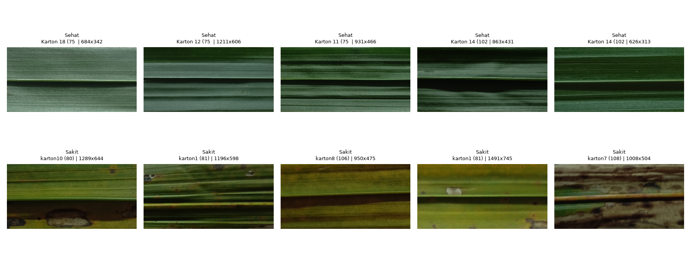
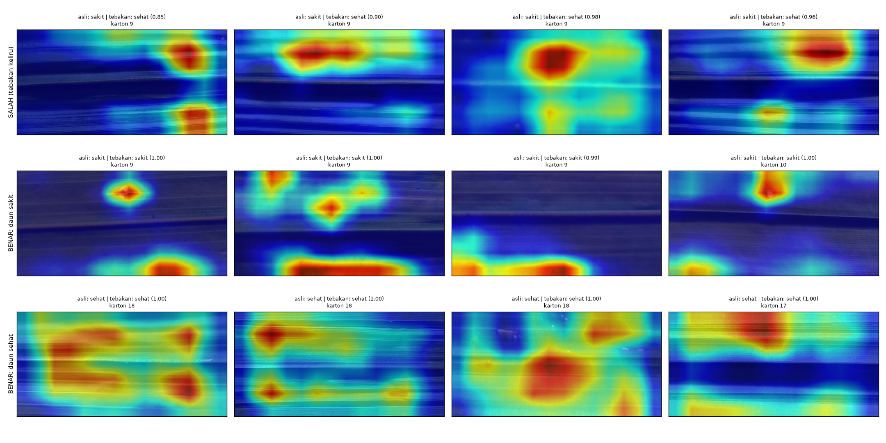
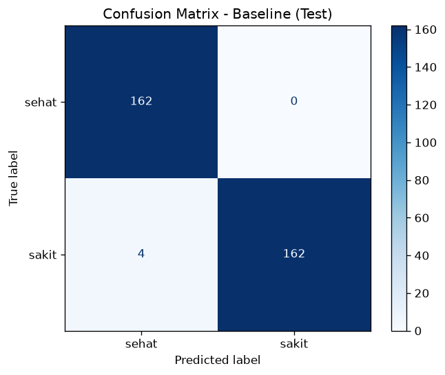

# 🌴 Oil Palm Leaf Disease Detection

Deep learning model that classifies close-up images of oil palm leaves as **healthy** or **diseased**, with a **Grad-CAM** view of the regions that influenced each prediction. Built as an end-to-end project: data analysis, validation, model training, explainability, and a deployed web demo.

**🔗 Live demo:** https://oil-palm-leaf-disease-detection-7k3zkjgnwcwji53ek9y7he.streamlit.app/
*(The free hosting puts the app to sleep when idle. If you see a wake-up button, click it and wait about a minute.)*

> ⚠️ Research prototype. It is not a diagnostic tool and does not replace an agronomist's assessment.

## Highlights

- **EfficientNet-B0** (transfer learning from ImageNet) trained on 1,583 close-up leaf images.
- **Validated by photo batch ("carton"), not by random split**, to reduce the risk of the model memorizing batch-specific photo characteristics.
- **Sanity checks** against shortcut learning: a color-only baseline, a grayscale experiment, and leave-cartons-out cross-validation.
- **Grad-CAM** explanations and a **Streamlit** demo.

## Results

| Experiment | Accuracy |
|---|---|
| Color-only baseline (6 color statistics per image, logistic regression), test set | 89.6% |
| EfficientNet-B0, test set (held-out cartons) | **98.8%** (324 of 328 correct) |
| EfficientNet-B0 on grayscale images, test set | 97.9% |
| EfficientNet-B0, leave-cartons-out cross-validation (4 folds, all 1,583 images) | **98.9%** (17 errors) |

Notes on the results:

- On the test set, the model missed 4 diseased leaves and raised no false alarms on healthy leaves. In cross-validation, 15 of the 17 errors were diseased leaves classified as healthy, which is the more costly direction for disease screening.
- All 4 test-set errors came from a single carton (carton 9), which is also the weakest carton in cross-validation (89.5%).
- Removing color reduced test accuracy by only about 1 point, so the model is not relying on color alone. This does not rule out other differences between photo batches.

| Cross-validation class report | Precision | Recall | Images |
|---|---|---|---|
| healthy | 0.978 | 0.997 | 684 |
| diseased | 0.998 | 0.983 | 899 |

### Figures

| Sample images | Grad-CAM | Confusion matrix (test) |
|---|---|---|
|  |  |  |

## Limitations (please read)

- **No external validation yet.** The model has not been tested on photos from other plantations, cameras, or sources. Accuracy on such photos is unknown and may be much lower.
- **Class and batch are confounded.** All diseased leaves come from cartons 1-10 and all healthy leaves from cartons 11-18, so the model may partly learn photo-session differences rather than disease symptoms. Holding out whole cartons reduces this risk but cannot remove it.
- **Binary only.** It does not identify the type of disease.
- **Overconfidence.** The model can be highly confident and still wrong, including on images that are not oil palm leaves.
- The Grad-CAM heatmap is a coarse visualization, not a segmentation of the diseased area.

## Data

- **Dataset:** *Image Dataset of Oil Palm Leaf Diseases* (Rahmanto & Arrahimi), Mendeley Data, DOI [10.17632/cp65skff89.1](https://data.mendeley.com/datasets/cp65skff89). Cropped leaf images from plantations in Tanah Laut, Indonesia, labeled healthy or diseased by domain experts.
- 1,583 images: 899 diseased and 684 healthy, grouped in 18 cartons.
- Split by carton: train 908, validation 347, test 328.
- The dataset is **not included** in this repository. Please refer to the dataset page for its license terms and cite the authors when using it.

## Method

1. **Split:** images are split by carton into train, validation, and test sets (`src/make_splits.py`).
2. **Model:** EfficientNet-B0 pretrained on ImageNet, final layer replaced with a 2-class head, all layers fine-tuned (`src/train_baseline.py`). Input 224x448 (matching the ~1:2 aspect ratio of the images), AdamW (lr 3e-4), 8 epochs, bfloat16 autocast. Augmentation: flips and color jitter. The best epoch is chosen on the validation set, and the test set is evaluated once.
3. **Checks:** color-only baseline (`src/check_color_baseline.py`), grayscale training (`src/train_grayscale.py`), and leave-cartons-out cross-validation (`src/cv_by_carton.py`).
4. **Explainability:** Grad-CAM on the last convolutional block (`src/gradcam_baseline.py`).
5. **Demo:** Streamlit app (`app/app.py`).

## Project structure

```
├── app/                 Streamlit demo (app.py, requirements.txt for deployment)
├── models/              trained weights (baseline_efficientnet_b0.pt)
├── reports/             metrics and figures
├── src/                 data split, training, validation and Grad-CAM scripts
├── .streamlit/          app theme
├── packages.txt         system package for deployment (OpenCV)
└── requirements.txt     dependencies for training
```

## Run it yourself

```bash
git clone https://github.com/danieltobingid-lang/oil-palm-leaf-disease-detection.git
cd oil-palm-leaf-disease-detection
python -m venv .venv
.venv\Scripts\activate          # Windows
pip install -r requirements.txt
```

For GPU training, install PyTorch with the CUDA build that matches your GPU (see pytorch.org). Then:

1. Download the dataset and place it in `data/raw/`.
2. `python src/make_splits.py`
3. `python src/train_baseline.py`
4. `python src/gradcam_baseline.py`
5. Demo: `streamlit run app/app.py`

## References

- Tan, M., & Le, Q. (2019). *EfficientNet: Rethinking Model Scaling for Convolutional Neural Networks.* arXiv:1905.11946.
- Atila, Ü., et al. (2021). *Plant leaf disease classification using EfficientNet deep learning model.* Ecological Informatics. DOI: 10.1016/j.ecoinf.2020.101182
- Rahmanto, O., Julianto, V., & Arrahimi, A. R. (2025). *Evaluating Random Forest Algorithm: Detection of Palm Oil Leaf Disease.* Brilliance 4(2). DOI: 10.47709/brilliance.v4i2.4798
- Ong, J. H., Ong, P., & Woon, K. L. (2022). *Image-Based Oil Palm Leaves Disease Detection Using Convolutional Neural Network.* Journal of ICT 21(3), 383-410.
- Indrawati, A., Rahman, A., Pane, E., & Muhathir (2023). *Classification of Diseases in Oil Palm Leaves Using the GoogLeNet Model.* Baghdad Science Journal. DOI: 10.21123/bsj.2023.8547

## Author

**Daniel L. Tobing**: Informatics student at President University (AI & Data Analysis).
[LinkedIn](https://www.linkedin.com/in/daniel-l-tobing-a70237410) · [GitHub](https://github.com/danieltobingid-lang)

Code is released under the MIT License (see `LICENSE`).